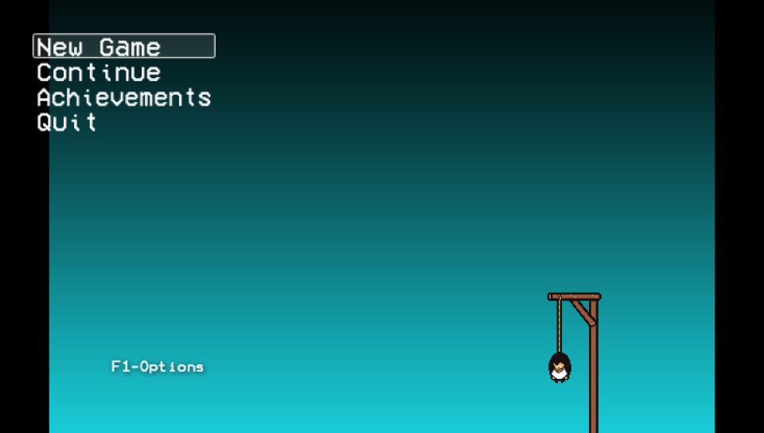
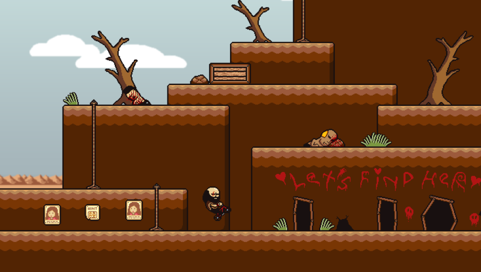
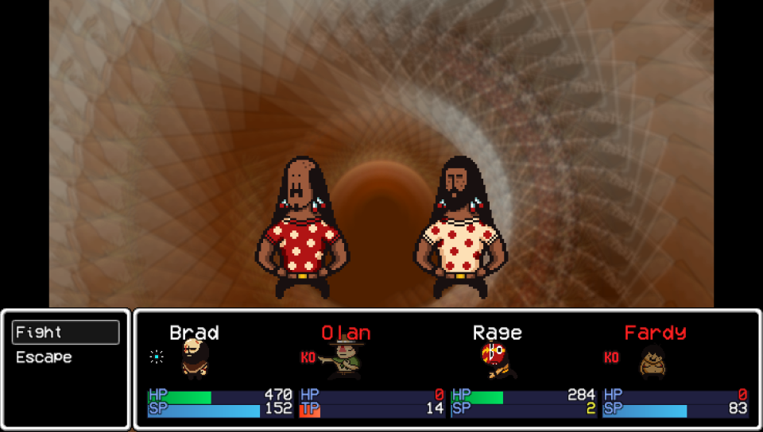
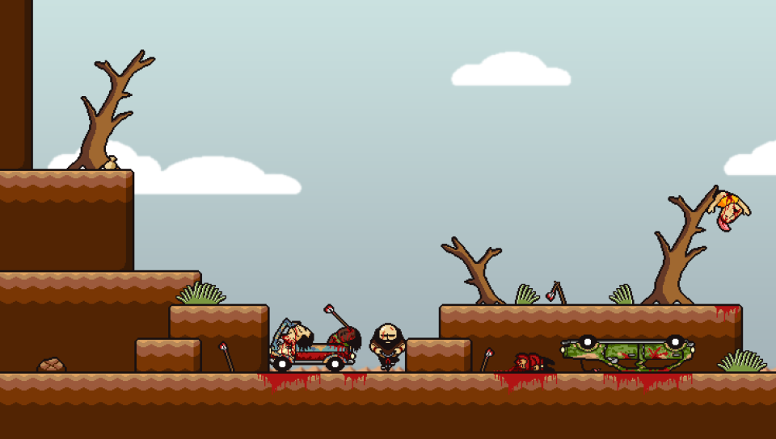
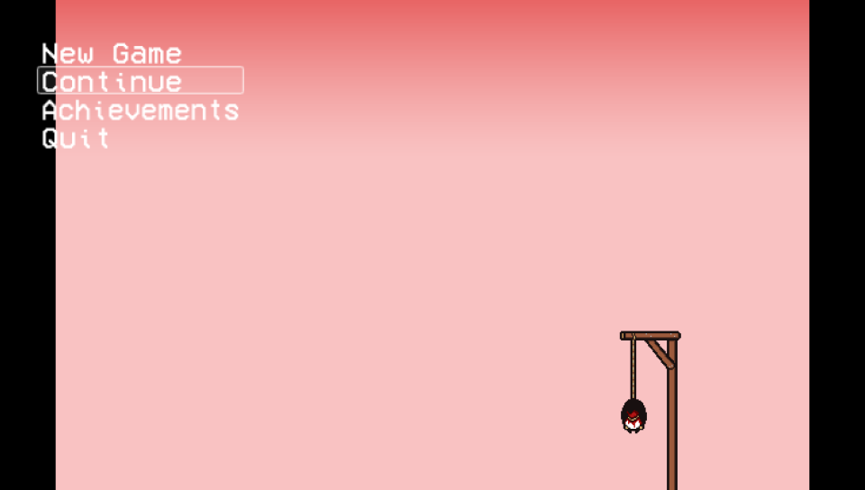
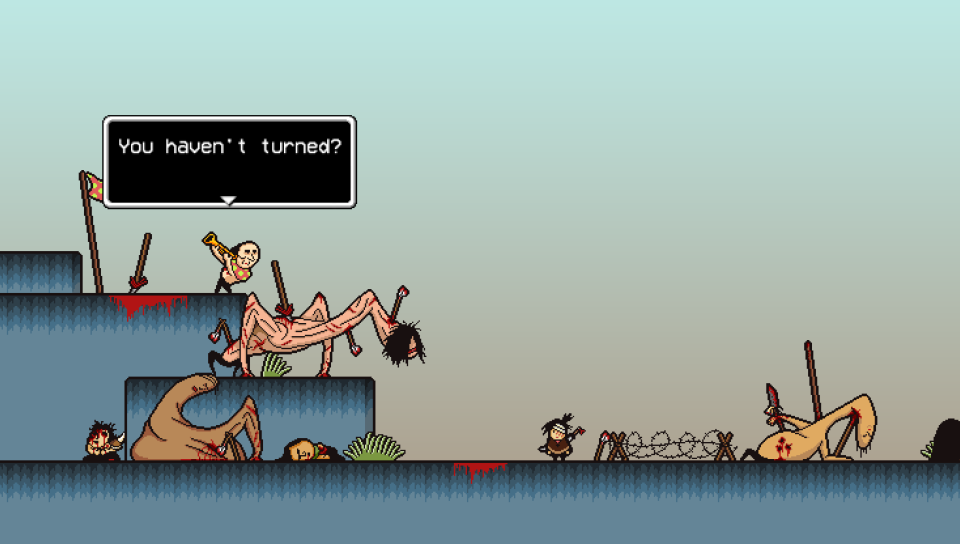
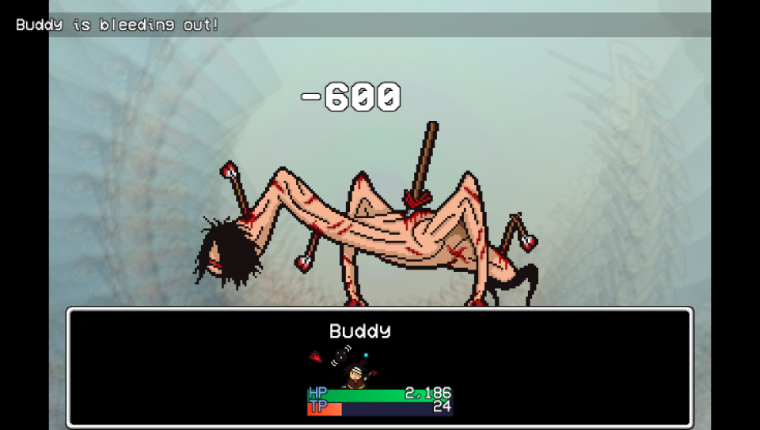
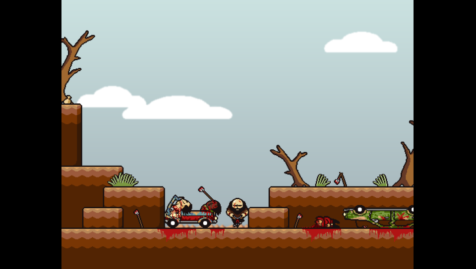

# LISA: The Painful — PS Vita Port

An unofficial native PS Vita port of **LISA: The Painful**, based on
mkxp-z and the RGSS3 runtime. **LISA: The Joyful** is supported too, as an experimental
second package.

> Current status: **Alpha 0.3** — LISA: The Painful is playable from start to finish on real hardware;
> LISA: The Joyful has been completed on hardware too (experimental).

> **Works only with the Legacy Edition** of LISA: The Painful / The Joyful (the original RPG Maker VX Ace
> games: `Game.exe`, `Game.rgss3a`, `Audio/`, `Graphics/`). The Definitive Edition by Serenity
> Forge is built with Unity and is **not** supported.

| | |
|---|---|
|  |  |
|  |  |

*Screenshots taken on a PS Vita (the last one with the Wide screen option).*

**LISA: The Joyful** (experimental package):

| | | |
|---|---|---|
|  |  |  |

## About

This project aims to make LISA: The Painful (and LISA: The Joyful) playable natively on PS Vita.

The port uses mkxp-z as its base, with extensive Vita-specific work for
rendering, audio, memory management, Ruby/RGSS3 compatibility and performance.
The game's own scripts run unchanged.

## Download

Get `LISA-Vita-alpha0.3.vpk` (LISA: The Painful) and, if you want, `LISA-Joyful-Vita-alpha0.3.vpk`
(LISA: The Joyful, experimental) from the [Releases](../../releases) page and install them with
VitaShell. The game files are not included: see [Installation](#installation).

## Current Status

The game is currently playable on real PS Vita hardware.

### New in Alpha 0.3

- **LISA: The Joyful** (experimental): a second package, "Lisa: The Joyful" (title ID `LISJ00001`,
  data in `ux0:data/lisa_joyful/`), with its own LiveArea and its 10 Steam achievements. The game has
  been completed on hardware; very long sessions can still run out of memory (save often).
- **MP3 sounds**: the game's MP3 music and sound effects (for example the TV in Marty's house) are
  no longer silent.
- **Wide screen fixes**: the game over picture is centred, and the dialogue boxes shown above a
  character in small rooms are placed over that character.
- **Logs** go to a `logs/` folder inside the game folder (`ux0:data/lisa_vita/logs/`).
- New LiveArea background. To see it when updating from an older alpha, delete the app and install the
  VPK again: saves and achievements are kept (they live in `ux0:data/`).

### New in Alpha 0.2

- **Screen options**: in the game menu (Circle → *Options/Quit* → *Screen*), choose with left / right:
  - **1:1** — the game's 544x416 pixels, not scaled, centred;
  - **Original** — the game's proportions scaled to the screen height (default);
  - **Stretch** — the same picture stretched to the whole screen (wider pixels);
  - **Wide** — real widescreen: the game is drawn at 736x416, showing more of each map. LISA was made
    for 544x416, so some scenes and events may look wrong in this mode.

  The choice is remembered.

  | Original | Wide |
  |---|---|
  |  |  |
- **Achievements**: the game's 58 Steam achievements are unlocked on the Vita (with their Steam titles
  and descriptions), shown in a window when you get one and listed under *Achievements* on the title
  screen. They are kept in `ux0:data/lisa_vita/achievements.dat`; achievements earned with Alpha 1 are
  picked up automatically.
- **Fixed**: the sky in some intro scenes was drawn as repeated bands instead of a gradient.

Tested functionality includes:

- Main story progression (the game has been completed on hardware)
- Maps and events
- Battles and combo input
- Save/load
- BGM, BGS, ME and SE
- Suspend/resume
- Custom RGSS3 scripts
- Vita controls, including both analog sticks
- Long-session stability testing

Performance is still being optimized, particularly on maps with a large
number of active events.

## Installation

This repository does **not** contain any LISA: The Painful game assets.

You must own a legitimate copy of the game (**Legacy Edition**, the RPG Maker VX Ace
version) and provide the required game files yourself:

1. Install the VPK.
2. Extract the game's `Game.rgss3a` archive (if your copy has one), for example with
   [rgss3a-extractor](https://github.com/iatsiuk/rgss3a-extractor).
3. Copy `Data/`, `Graphics/`, `Audio/` and `Fonts/` to `ux0:data/lisa_vita/` (LISA: The Joyful:
   `ux0:data/lisa_joyful/`).

The first launch pauses for about 10 seconds while the shaders are compiled;
later launches are fast.

See the [Installation Guide](docs/INSTALLATION.md) for the details.

## Controls

| Vita | Game |
|---|---|
| D-pad or left stick | Move / select |
| Cross | Confirm |
| Circle | Cancel / menu |
| L / R | Previous / next page in menus |
| Triangle (or R), Square, Cross, Circle | Combo keys W, A, S, D in battle |
| Right stick up / left / down / right | Combo keys W, A, S, D |

In battle, the combo skill descriptions show the PlayStation buttons instead of
the PC keys.

The "F1 - Options" text on the title screen belongs to the PC version (the RPG Maker
player's settings window). On the Vita the game's options are in the game menu:
Circle → *Options/Quit*.

## Compatibility / Known Issues

This is still an alpha quality port but the game is totally playable from start to finish.

Known limitations and performance issues are documented in
[Known Issues](docs/KNOWN_ISSUES.md).

## Performance

The port targets 60 FPS: exploration and battles run at or near 60 FPS most
of the time, with occasional short stutters.

Performance depends heavily on the number and complexity of RGSS3 events
running on a map. Significant optimization work has already been done to move
performance-critical code from Ruby into native code.

Tested with [PSVshell](https://github.com/Electry/PSVshell) at 500/222/222/166 MHz;
at stock clocks performance may be lower.

## Technical Information

The Vita port includes work on:

- mkxp-z / RGSS3 adaptation
- Ruby 3.1 cross-compiled for the Vita, with Fibers on a pthread pool
- Vita rendering backend (vitaGL)
- audio streaming
- custom memory management
- Vita suspend/resume handling
- Vita-specific performance optimizations

More information is available in [Technical Notes](docs/TECHNICAL.md).

## Building

See [Building](docs/BUILDING.md).

## Disclaimer

This is an unofficial, free, non-commercial fan project and is not affiliated
with Dingaling Productions, Serenity Forge or the official developers/publishers
of LISA.

No game files are distributed with this project: you need your own copy of the
game. The LiveArea backgrounds are cropped from the official Definitive Edition key art
(© Dingaling Productions / Serenity Forge); the bubble icon of LISA: The Painful is fan
artwork based on the game.

## Credits

See [CREDITS.md](CREDITS.md).

## License

See [LICENSE](LICENSE).
